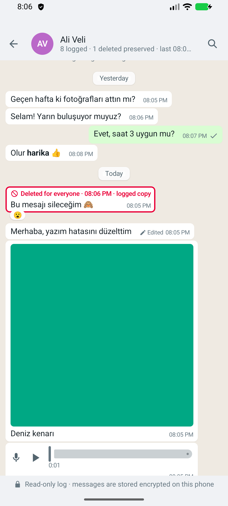
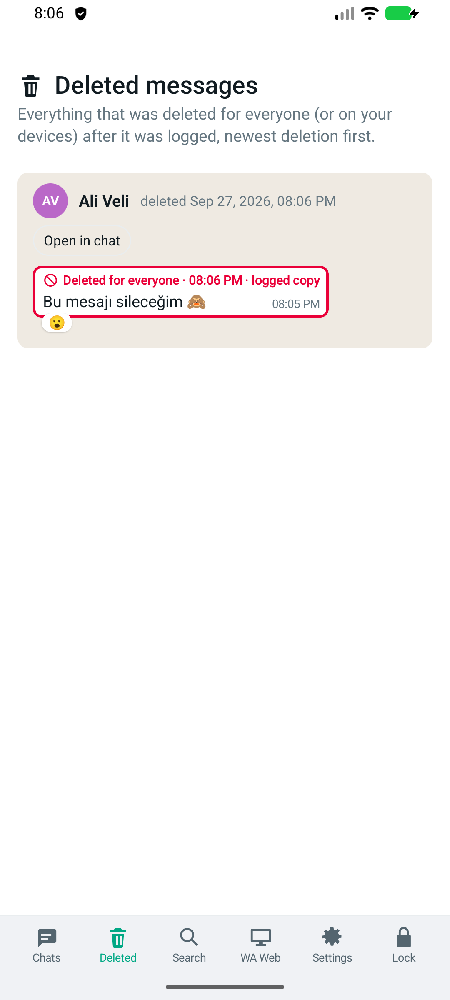
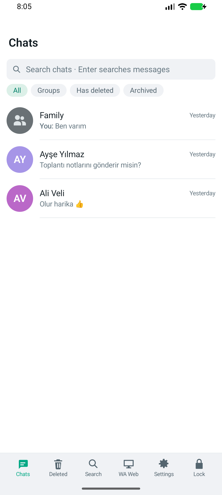
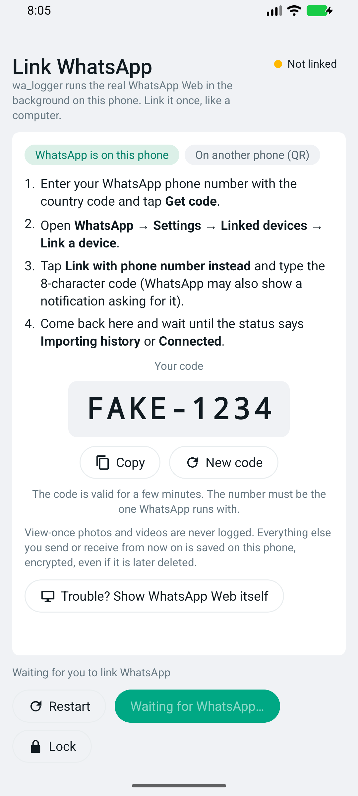

# wa_logger mobile

**wa_logger on your phone, with no server.** An Android app that runs the real WhatsApp Web in the background on the
phone itself, records every message, photo, video, voice note, document, edit and reaction your account sends or
receives, encrypted on the phone, and keeps it **even after the sender deletes it**.

It does what [wa_logger](https://github.com/revocx35/wa_logger) does (a Docker server with a web UI) without the
server: WhatsApp Web, the logger, the encrypted database and the WhatsApp-style reader all live in one app. The
screens look like wa_logger's web UI.

<p>
  
  
  
  
</p>

_(Screenshots show demo data.)_

## Features

- **Anti-delete:** messages deleted for everyone (or by a group admin) stay readable and are flagged in red.
  The **Deleted** page lists every deletion, and an optional notification tells you when one happens.
- **Edit history:** earlier versions of edited messages are kept.
- **All message types** except view-once media: text with WhatsApp formatting, photos, videos, GIFs, voice notes,
  audio, documents, stickers, locations, contact cards, polls, calls, group events, reactions, replies, forwards and
  status updates (optional).
- **Media is downloaded immediately**, before it can be deleted, and stored encrypted. Videos play with seeking.
- **History import** of the last messages of every chat when you link (200 per chat by default).
- **Search** across all messages, globally or per chat.
- **WA Web** page: open the live WhatsApp Web session that runs in the background.
- **Runs in the background** as a foreground service with a small permanent notification, restarts after a reboot,
  and warns you if WhatsApp gets unlinked.
- **Locked by a password** (fingerprint unlock optional). Logging continues while the app is locked.
- Light and dark theme, phone and tablet layouts.

**View-once photos and videos are not logged, by design.**

> ⚠️ This app uses WhatsApp Web in an unofficial way. Automating WhatsApp may break its Terms of Service and could get
> the account restricted. Use it only for your own account and at your own risk. Laws about recording
> communications differ by country. Not affiliated with WhatsApp or Meta.

## How it works

```
┌──────────────────────────── the app (one process) ───────────────────────────┐
│  foreground service ── hidden WebView: https://web.whatsapp.com               │
│                           └─ page bridge (walm-bridge.js) ── events, history, │
│                                                              media, QR/code   │
│                                 │ origin-restricted message port              │
│  engine ─ ingest ─ encrypt ─ SQLite + encrypted media files                   │
│                                 │                                             │
│  UI (Compose, wa_logger's design) ── unlock with password ── read & decrypt   │
└──────────────────────────────────────────────────────────────────────────────┘
```

The WhatsApp Web page is the same one you would open on a computer. It is linked to your account as a **linked
device** (it uses one of WhatsApp's linked-device slots). A small script inside the page, adapted from
[whatsapp-web.js](https://github.com/wwebjs/whatsapp-web.js), reports new messages, edits, deletions and reactions
to the app, which stores them encrypted. Details: [ARCHITECTURE.md](ARCHITECTURE.md).

## Install

From [F-Droid](https://f-droid.org/packages/io.github.revocx35.walmobile/) (once it is published there), or from
GitHub:

1. Download `wa_logger_mobile-<version>.apk` from [Releases](https://github.com/revocx35/wa_logger_mobile/releases).
2. Open it on the phone and allow installing from this source.
3. Optional: check the signing certificate. Its SHA-256 is
   `A6:A8:45:C2:0C:C6:F4:3A:9C:90:5F:9B:DF:83:7A:19:D5:09:BB:86:F5:C9:E5:C1:36:60:92:43:5C:8F:37:19`
   (`apksigner verify --print-certs wa_logger_mobile-<version>.apk`). Updates are signed with the same key.

F-Droid builds the app from source and publishes it only if its build is identical to the GitHub APK, so both are
the same file with the same signature, and you can switch between them without reinstalling (reinstalling would
delete the log).

Requires Android 8.0 or newer and an up-to-date **Android System WebView** (or Chrome), which is what runs WhatsApp
Web. Fingerprint unlock needs Android 11+.

## First run

1. **Choose a password** (8+ characters; a passphrase is best). It encrypts your log.
2. **Save the recovery key.** It is shown once and is the only way back in if you forget the password. Without both,
   the log cannot be decrypted by anyone, by design.
3. **Allow notifications**, so you hear about unlinks and deleted messages.
4. **Link WhatsApp:**
   - **WhatsApp is on this phone:** enter your number (with country code) and tap **Get code**. Then open
     **WhatsApp → Settings → Linked devices → Link a device → Link with phone number instead** and type the
     8-character code. WhatsApp also shows a notification asking for it.
   - **WhatsApp is on another phone:** switch to **On another phone (QR)** and scan the QR code with that phone
     (**Linked devices → Link a device**).
5. When the status says **Connected** (or **Importing history**), tap **Complete**.

From now on, every new message is logged.

## Keep it running

Android is aggressive about stopping background apps. For reliable logging:

- **Settings → Background → Allow unrestricted battery use.** Without it, Android may stop WhatsApp Web when the
  phone sleeps.
- Some phones (Xiaomi, Huawei, Samsung, OnePlus, …) have their own battery savers on top; see
  [dontkillmyapp.com](https://dontkillmyapp.com) for your model.
- **Keep processing with the screen off** (Settings → Background) holds a partial wake lock so events are handled at
  once. It costs battery; without it, messages that arrive while the phone sleeps are picked up when it wakes, and a
  catch-up pass re-reads recent messages every 10 minutes.
- The permanent **"Logging your WhatsApp messages"** notification is required by Android for background work. You can
  minimize it in the system's notification settings.

## Using it

| Menu | What it does |
|---|---|
| **Chats** | WhatsApp-style chat list (filters: groups, chats with deleted messages, archived) and the chat view |
| **Deleted** | Every message deleted after it was logged, newest first, with a link into its chat |
| **Search** | Search over messages, captions, polls, locations and contact names |
| **WA Web** | Status, restart, unlink, and the live WhatsApp Web page |
| **Settings** | Password, fingerprint unlock and auto-lock, recovery key, logging options, background, storage, security log, wipe |
| **Lock** | Locks the app (logging continues) |

In a chat, deleted messages have a **red frame** and the time they were deleted. **Edited** opens the edit history.
Media that could not be downloaded shows the reason and a **Retry** button.

## What gets logged, and the limits

- Messages are captured **while WhatsApp Web runs on the phone and is linked**. After a gap (phone off, app stopped),
  WhatsApp Web delivers what arrived meanwhile and a catch-up pass re-reads recent messages, including deletions,
  as long as WhatsApp still has them.
- A message deleted **before** the app saw it cannot be recovered.
- Media above the size limit (default 100 MB, changeable) is not downloaded automatically. Old media from the history
  import may no longer be available on WhatsApp's servers.
- WhatsApp unlinks devices whose main phone stays offline for about 14 days. If the app is unlinked, a banner and a
  notification tell you; link again from **WA Web**.
- Deleting the app deletes the log and the WhatsApp Web session. Android backups are disabled for this app on
  purpose.

## Security at a glance

See [SECURITY.md](SECURITY.md) and [ARCHITECTURE.md](ARCHITECTURE.md).

- **Encryption at rest** as in wa_logger: message text, names, thumbnails and every media file are encrypted
  (AES-256-GCM) under data keys wrapped to a P-256 key pair. The private key is encrypted with your password
  (scrypt) and, separately, with the recovery key. The logger only holds the public key, so it **writes while the app
  is locked but cannot read** anything; a copy of the app's files is useless without the password or recovery key.
- **Unlock throttle:** after 5 wrong passwords, waits grow from 30 s to 1 h (kept in the database).
- **Fingerprint unlock** keeps a copy of the private key under an Android Keystore key that works only right after a
  strong biometric check, and is invalidated when fingerprints change.
- **No servers, no analytics.** Nothing leaves the phone except WhatsApp Web's own traffic and profile pictures from
  WhatsApp's CDN. Crash reports stay on the phone (Settings → App → Crash reports) and never contain content.
- **Screenshots are blocked** by default. No backups. HTTPS only, system CAs only.
- The WhatsApp Web page can reach the app only through an origin-restricted message port; the page is never shown
  unless you open it, links out of it open only when you tap them, and file access, downloads and permissions are
  denied.

## Build from source

JDK 21 and the Android SDK (compile SDK 37).

```bash
./gradlew :core:test :app:testDebugUnitTest :app:lintDebug :app:assembleDebug   # tests + debug APK
node --test bridge-test/*.test.mjs                                               # page bridge tests (Node 22+)
./gradlew :app:assembleRelease                                                    # minified; signed if keystore.properties exists
```

End-to-end on an emulator (no WhatsApp account needed: test builds can serve a fake WhatsApp Web):

```bash
scripts/emulator.sh start
./gradlew :app:assembleDebug && python3 scripts/e2e.py
./gradlew :app:assembleE2e && E2E_APK=app/build/outputs/apk/e2e/app-e2e.apk E2E_PKG=io.github.revocx35.walmobile.e2e python3 scripts/e2e.py
```

## License

wa_logger mobile is free software, licensed under the [GNU General Public License v3.0 or later](LICENSE)
(GPL-3.0-or-later).

## Credits

The WhatsApp Web integration is adapted from [whatsapp-web.js](https://github.com/wwebjs/whatsapp-web.js)
(Apache-2.0, see [NOTICE](NOTICE)). Design, data model and encryption follow
[wa_logger](https://github.com/revocx35/wa_logger), whose Android client provided the UI.
